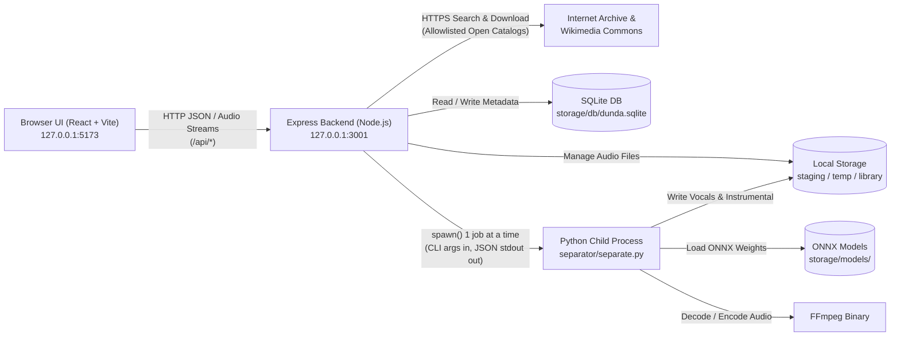

# Architecture Overview ("Dunda na Fes")

**Last Updated:** 2026-10-28 (Phase 8 — Final Audit)

---

## 1. Strict Component Boundaries

**Dunda na Fes** is divided into three strictly isolated code layers plus a local runtime storage directory:

1. **Frontend (`frontend/`) — React 18 + Vite 6 + Tailwind CSS v4 + Lucide React**
   - Runs in your browser at `http://127.0.0.1:5173`.
   - **Rule:** Never touches the filesystem, SQLite, or Python directly. Communicates exclusively with the Backend over HTTP (`/api/*`).
2. **Backend (`backend/`) — Node.js (`v24.14.1`) + Express 4 + `node:sqlite`**
   - Runs on your machine at `http://127.0.0.1:3001`.
   - Owns the SQLite database (`storage/db/dunda.sqlite`), manages files in `storage/staging/`, `storage/library/`, and `storage/temp/`, queries approved public music catalogs (`archive.org`, `commons.wikimedia.org`), and enforces the 1-job-at-a-time FIFO processing queue.
   - **Rule:** Never contains AI model math. Invokes `separator/separate.py` strictly as a one-shot child process per job.
3. **Separator (`separator/`) — Python 3.13 + `audio-separator[cpu]==0.47.1`**
   - Runs inside an isolated virtual environment (`separator/.venv`).
   - **Rule:** Never talks to the browser or the SQLite database. Reads one input audio file, pre-decodes/normalizes it via FFmpeg (`44.1 kHz` 2-channel stereo PCM), verifies it is not corrupt or 100% silent, writes two output stem files (`vocals.wav` and `instrumental.wav`), emits structured JSON lines on `stdout`, and exits with a documented exit code.

---

## 2. System Diagram

---

## 3. How a Song Moves Through the System (End-to-End Flow)

1. **Discover or Upload to Staging (Phase 4 / Phase 7 / Phase 8):**
   - A song is either uploaded from your PC in **Staging** or downloaded from an approved openly licensed catalog (**Internet Archive** or **Wikimedia Commons**) in **Discover**.
   - The backend validates its file extension, size (`<= 100 MB`), binary file header (magic bytes), and structural integrity (`ffprobe` positive duration check), assigns a safe server-generated UUID filename, and stores it in `storage/staging/`.
2. **Queue & Process (Phase 4 / Phase 6 / Phase 8):**
   - When you click **Separate** and choose a display name (auto-suggested or custom, with live Windows filename sanitization) and AI model (`UVR-MDX-NET-Inst_HQ_3.onnx` default or `Kim_Vocal_2.onnx` fallback), the backend creates a job record in SQLite (`status = 'queued'`).
   - The queue worker processes strictly **one job at a time** in FIFO order, spawning `separator/separate.py` targeting a job-specific folder inside `storage/temp/job-<jobId>`.
   - `separate.py` checks free disk space, pre-decodes the audio to 44.1 kHz stereo PCM (handling mono and compressed formats uniformly), checks for 100% digital silence, runs chunked MDX-Net ONNX inference (`chunk_duration=300`), and emits real-time JSON progress updates on `stdout`.
3. **Completion & Library Storage (Phase 3 / Phase 4 / Phase 5):**
   - When `separate.py` exits with code `0`, the backend moves the finished `vocals.wav` and `instrumental.wav` stems into `storage/library/<libraryId>/`, creates the permanent Library row in SQLite (automatically appending `(2)`, `(3)` on duplicate display names), deletes `storage/temp/job-<jobId>`, and removes the staged original file.
4. **Failure, Cancellation, & Restart Recovery (Phase 3 / Phase 4 / Phase 8):**
   - Cancelling a running job terminates the entire Python/FFmpeg process tree (`taskkill /PID <pid> /T /F` on Windows) and cleans up `storage/temp/job-<jobId>`.
   - If the server is restarted while a job is `running` or `queued`, startup recovery marks interrupted jobs as `failed` (`INTERRUPTED_BY_RESTART`) and purges any leftover folders in `storage/temp/`.
