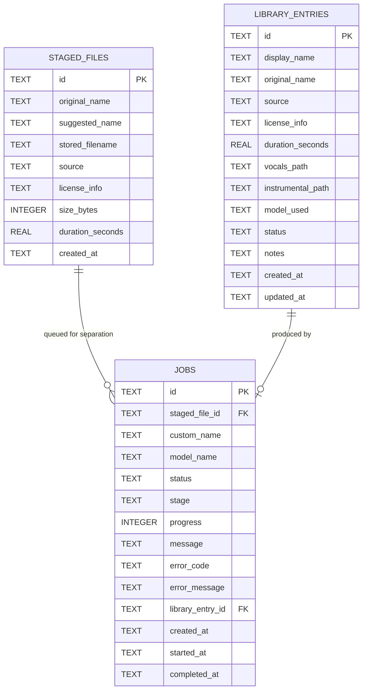

# Data Model & File Storage Layout ("Dunda na Fes")

**Last Updated:** 2026-10-22 (Phase 3)

This document explains every SQLite table, column, and on-disk folder structure used by **Dunda na Fes**, along with how database migrations and server restarts work.

---

## 1. Database Engine & Migrations Approach

- **Engine:** Node.js built-in synchronous SQLite (`node:sqlite` -> `DatabaseSync`).
- **Database File Location:** `storage/db/dunda.sqlite` (configurable via `DB_PATH` in `backend/.env`).
- **Pragmas Enabled on Connection:**
  - `PRAGMA journal_mode = WAL;` — Write-Ahead Logging allows concurrent reads while a write is happening and prevents database corruption on unexpected power loss.
  - `PRAGMA foreign_keys = ON;` — Enforces relational integrity between tables.
- **Numbered SQL Migrations (`backend/src/db/migrations.js`):**
  - Instead of relying on a heavy ORM, we maintain a `schema_migrations` table (`version INTEGER PRIMARY KEY`, `name TEXT`, `applied_at TEXT`).
  - On server startup, `runMigrations(db)` checks which migration versions have already been applied and runs any new migrations inside a database transaction (`BEGIN` ... `COMMIT`, or `ROLLBACK` on error).

---

## 2. Tables & Fields Explained

### Table 1: `staged_files`
Tracks songs waiting in the **Staging** area (imported via file upload or downloaded from Discover) before or during separation.

| Column | SQLite Type | Constraints | Why This Field Exists |
| :--- | :--- | :--- | :--- |
| `id` | `TEXT` | `PRIMARY KEY` | Server-generated UUID (e.g. `f47ac10b-...`). Never trusts user input. |
| `original_name` | `TEXT` | `NOT NULL` | The original filename from your PC or track title from Discover (e.g. `"03 Swanee.mp3"`). |
| `suggested_name` | `TEXT` | `NOT NULL` | A cleaned-up, human-friendly name suggested by the server for the output (e.g. `"Swanee"`). |
| `stored_filename` | `TEXT` | `NOT NULL` | Safe server-generated filename inside `storage/staging/` (e.g. `<id>.mp3`). Prevents path traversal. |
| `source` | `TEXT` | `NOT NULL CHECK(source IN ('upload', 'discover'))` | Records whether the song came from a local upload or the legal Discover catalogue. |
| `license_info` | `TEXT` | `NOT NULL DEFAULT 'Personal Local File'` | Stores the track's license (e.g. `"CC BY 4.0"`, `"Public Domain Mark 1.0"`, or `"Personal Local File"`). |
| `size_bytes` | `INTEGER` | `NOT NULL CHECK(size_bytes > 0)` | File size in bytes (displayed in the Staging UI). |
| `duration_seconds` | `REAL` | `NULL` | Audio duration in seconds (inspected via `ffprobe`), or `NULL` if unknown. |
| `created_at` | `TEXT` | `NOT NULL` | ISO-8601 UTC timestamp when the file was staged. |

---

### Table 2: `library_entries`
Tracks finished separation results in your permanent **Library**.

| Column | SQLite Type | Constraints | Why This Field Exists |
| :--- | :--- | :--- | :--- |
| `id` | `TEXT` | `PRIMARY KEY` | Server-generated UUID for the library entry. |
| `display_name` | `TEXT` | `NOT NULL` | The name chosen by you (or accepted from the suggestion). Duplicate names automatically get `(2)`, `(3)`, etc. |
| `original_name` | `TEXT` | `NOT NULL` | The original filename or track title before separation. |
| `source` | `TEXT` | `NOT NULL CHECK(source IN ('upload', 'discover'))` | Where the source audio originated (`'upload'` or `'discover'`). |
| `license_info` | `TEXT` | `NOT NULL DEFAULT 'Personal Local File'` | License string preserved from staging/Discover so every library item shows its license. |
| `duration_seconds` | `REAL` | `NULL` | Length of the song in seconds. |
| `vocals_path` | `TEXT` | `NOT NULL` | Relative path inside `storage/library/` to the isolated vocals file (e.g. `<id>/vocals.wav`). |
| `instrumental_path` | `TEXT` | `NOT NULL` | Relative path inside `storage/library/` to the clean instrumental file (e.g. `<id>/instrumental.wav`). |
| `model_used` | `TEXT` | `NOT NULL` | Exact ONNX model that produced these stems (e.g. `"UVR-MDX-NET-Inst_HQ_3.onnx"`). |
| `status` | `TEXT` | `NOT NULL DEFAULT 'ready' CHECK(status IN ('ready', 'error'))` | Readiness state of the library entry (`'ready'`). |
| `notes` | `TEXT` | `NOT NULL DEFAULT ''` | Optional user notes editable via `PATCH /api/library/:id`. |
| `created_at` | `TEXT` | `NOT NULL` | ISO-8601 UTC timestamp when the entry was created. |
| `updated_at` | `TEXT` | `NOT NULL` | ISO-8601 UTC timestamp when the entry was last renamed or updated. |

---

### Table 3: `jobs`
Tracks audio separation jobs in the **1-job-at-a-time processing queue**.

| Column | SQLite Type | Constraints | Why This Field Exists |
| :--- | :--- | :--- | :--- |
| `id` | `TEXT` | `PRIMARY KEY` | Server-generated UUID for the separation job. |
| `staged_file_id` | `TEXT` | `NULL` | ID of the staged song being processed (kept nullable so job history survives after the staged file is cleaned up). |
| `custom_name` | `TEXT` | `NOT NULL` | The display name requested for the resulting Library entry. |
| `model_name` | `TEXT` | `NOT NULL` | The requested ONNX model filename. |
| `status` | `TEXT` | `NOT NULL CHECK(status IN ('queued', 'running', 'completed', 'failed', 'cancelled'))` | Current lifecycle state of the job. |
| `stage` | `TEXT` | `NOT NULL DEFAULT 'queued'` | Current sub-step (`'queued'`, `'starting'`, `'loading_model'`, `'separating'`, `'exporting'`, `'done'`). |
| `progress` | `INTEGER` | `NOT NULL DEFAULT 0 CHECK(progress >= 0 AND progress <= 100)` | Percentage (`0` to `100`) updated live from `separate.py`'s JSON stdout. |
| `message` | `TEXT` | `NOT NULL DEFAULT ''` | Human-readable status message (e.g. `"Separating audio chunks (12/37)..."`). |
| `error_code` | `TEXT` | `NULL` | Machine-readable error code if `status = 'failed'` (e.g. `'FFMPEG_MISSING'`, `'INTERRUPTED_BY_RESTART'`). |
| `error_message` | `TEXT` | `NULL` | Friendly, human-readable error message shown in the UI if `status = 'failed'`. |
| `library_entry_id` | `TEXT` | `NULL` | Links to `library_entries.id` once the job completes. |
| `created_at` | `TEXT` | `NOT NULL` | When the job was queued. |
| `started_at` | `TEXT` | `NULL` | When the Python separator child process started. |
| `completed_at` | `TEXT` | `NULL` | When the job finished, failed, or was cancelled. |

---

## 3. Entity-Relationship Diagram



---

## 4. On-Disk File Storage Layout (`storage/`)

```text
storage/
├── db/
│   └── dunda.sqlite                 # SQLite database + WAL files
├── models/
│   ├── UVR-MDX-NET-Inst_HQ_3.onnx   # Default model (~64.0 MB)
│   └── Kim_Vocal_2.onnx             # Fallback model (~66.8 MB)
├── staging/
│   └── <staged_file_id>.<ext>       # Staged original audio waiting to be processed
├── temp/
│   └── job-<job_id>/                # Ephemeral working folder per running job (deleted on finish/startup)
│       ├── vocals.wav
│       └── instrumental.wav
└── library/
    └── <library_entry_id>/          # Permanent folder per Library item (deleted when entry is deleted)
        ├── vocals.wav
        └── instrumental.wav
```

---

## 5. Server Restart & Crash Recovery Behavior

Because `separator/separate.py` runs as a child process of the Node.js backend, if the computer loses power or the backend server is stopped mid-job:
1. On the next server startup, `recoverInterruptedJobsAndCleanupTemp()` runs automatically before the HTTP server accepts requests.
2. Any rows in `jobs` where `status IN ('queued', 'running')` are immediately updated to:
   - `status = 'failed'`
   - `error_code = 'INTERRUPTED_BY_RESTART'`
   - `error_message = 'Job was interrupted because the server was restarted before processing finished.'`
   - `completed_at = <current timestamp>`
3. Any leftover `job-*` directories inside `storage/temp/` are deleted from disk so partial `.wav` files never waste disk space.
